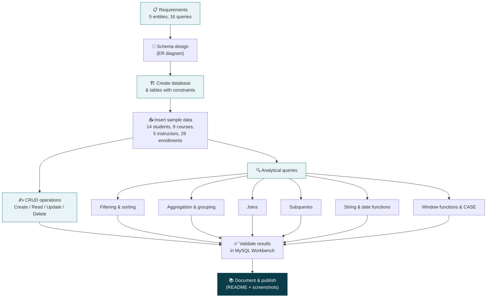
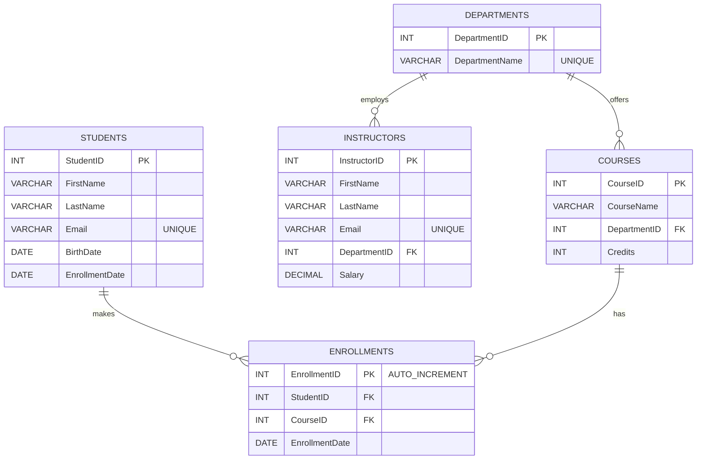

<div align="center">

# 🎓 University Course Management System

**A complete relational database project in MySQL: schema design, CRUD, joins, subqueries, aggregations and window functions**


</div>

---

## 📑 Table of Contents
1. [Project Overview](#-project-overview)
2. [Objectives](#-objectives)
3. [Tech Stack](#-tech-stack)
4. [Project Workflow](#-project-workflow)
5. [Database Design](#-database-design)
6. [Repository Structure](#-repository-structure)
7. [How to Run](#-how-to-run)
8. [Query Catalog](#-query-catalog)
9. [Queries & Output Screenshots](#-queries--output-screenshots)
10. [Key Results](#-key-results)
11. [Skills Demonstrated](#-skills-demonstrated)
12. [Design Notes & Future Improvements](#-design-notes--future-improvements)
13. [About the Author](#-about-the-author)

---

## 🌟 Project Overview

This **Final Project** brings together the major SQL concepts in one working system: a **University Course Management System** that tracks **students, courses, instructors, enrollments and departments**.

The project covers the full cycle: designing normalized tables with keys and constraints, loading realistic data, performing **CRUD operations**, and writing **16 queries** that range from simple filtering to window functions and `CASE` logic.

> 📦 **Deliverable:** one executable script, [`University_Course_Management.sql`](sql/University_Course_Management.sql), that builds the database, loads the data and runs every query.

---

## 🎯 Objectives

- 🏗️ Design a relational schema with **primary keys, foreign keys and constraints**
- ✍️ Perform **CRUD** (Create, Read, Update, Delete) operations on all tables
- 🔎 Filter, sort and limit data with `WHERE`, `ORDER BY` and `LIMIT`
- 📊 Summarize data with **aggregations** (`COUNT`, `AVG`, `MAX`) and `GROUP BY` / `HAVING`
- 🔗 Combine tables with **INNER JOIN** and **LEFT JOIN**
- 🧩 Solve multi-step problems with **subqueries**
- 🔤 Manipulate text and dates (`CONCAT`, `EXTRACT`, `DATE_SUB`)
- 🪟 Use **window functions** (running totals) and the **`CASE`** expression

---

## 🛠️ Tech Stack

| Layer | Tool |
|---|---|
| 🗄️ Database | **MySQL 8.0** |
| 🖥️ Client | **MySQL Workbench** |
| 📝 Documentation | Markdown, Mermaid diagrams |

---

## 🔄 Project Workflow



---

## 🗂️ Database Design

### Entity-Relationship Diagram



### Tables at a glance

| # | Table | Purpose | Rows loaded |
|---|---|---|---|
| 1 | 👩‍🎓 `Students` | Student details | 14 |
| 2 | 📘 `Courses` | Courses and credits, linked to a department | 9 |
| 3 | 👨‍🏫 `Instructors` | Instructor details and salary | 5 |
| 4 | 📝 `Enrollments` | Which student takes which course (many-to-many link) | 29 |
| 5 | 🏛️ `Departments` | Academic departments | 2 |

**Integrity rules:** every foreign key is enforced, emails are `UNIQUE`, and `UNIQUE (StudentID, CourseID)` stops a student from enrolling in the same course twice.

---

## 📁 Repository Structure

```
University-Course-Management-System/
├── README.md
├── sql/
│   └── University_Course_Management.sql   # Schema + sample data + all 16 queries
└── images/                                # Query output screenshots used in this README
```

---

## 🚀 How to Run

1. Install **MySQL 8.0+** and **MySQL Workbench**.
2. Open `sql/University_Course_Management.sql` in Workbench.
3. Click the ⚡ lightning bolt (or press `Ctrl + Shift + Enter`) to run the whole script.
4. Check the **Result Grid** tabs for each query's output.

> 💡 The script starts with `DROP DATABASE IF EXISTS UniversityDB;`, so it is safe to re-run from scratch.

---

## 🧭 Query Catalog

| # | Task | Concepts used |
|---|---|---|
| 1 | CRUD on all tables | `INSERT`, `SELECT`, `UPDATE`, `DELETE`, foreign-key order |
| 2 | Students who enrolled after 2022 | `WHERE`, date comparison, `ORDER BY` |
| 3 | Mathematics courses (limit 5) | `JOIN`, `LIMIT` |
| 4 | Students per course (more than 5) | `GROUP BY`, `HAVING`, `COUNT` |
| 5 | Students in **both** SQL and Data Structures | `HAVING COUNT(DISTINCT …)` |
| 6 | Students in **either** course | `OR`, `DISTINCT` |
| 7 | Average credits of all courses | `AVG`, `ROUND` |
| 8 | Max salary in Computer Science | `MAX`, `JOIN` |
| 9 | Students per department | `LEFT JOIN`, `COUNT(DISTINCT …)` |
| 10 | Students and their courses | `INNER JOIN` (3 tables) |
| 11 | All students, with courses if any | `LEFT JOIN` |
| 12 | Students in courses with more than 10 students | Subquery with `IN` |
| 13 | Year of enrollment | `EXTRACT(YEAR FROM …)` |
| 14 | Instructor full name | `CONCAT` |
| 15 | Running total of enrollments | Window function `SUM() OVER` |
| 16 | Senior / Junior label | `CASE`, `DATE_SUB`, `CURDATE` |

---

## 🖼️ Queries & Output Screenshots

### 🧱 Q1: CRUD Operations (all 5 tables)

Test rows use IDs `100+` and `200`, so the original data stays untouched. They are deleted at the end, **child tables first** to respect the foreign keys.

```sql
-- CREATE
INSERT INTO Departments (DepartmentID, DepartmentName) VALUES (3, 'Physics');
INSERT INTO Students (StudentID, FirstName, LastName, Email, BirthDate, EnrollmentDate)
VALUES (100, 'Test', 'User', 'test.user@email.com', '2001-01-01', '2024-08-01');
INSERT INTO Courses (CourseID, CourseName, DepartmentID, Credits) VALUES (200, 'Quantum Basics', 3, 3);
INSERT INTO Instructors (InstructorID, FirstName, LastName, Email, DepartmentID, Salary)
VALUES (100, 'Zed', 'Walker', 'zed.walker@univ.com', 3, 65000.00);
INSERT INTO Enrollments (StudentID, CourseID, EnrollmentDate) VALUES (100, 200, '2024-08-01');

-- READ
SELECT * FROM Departments;  SELECT * FROM Students;  SELECT * FROM Courses;
SELECT * FROM Instructors;  SELECT * FROM Enrollments;
```

**✅ Row counts, Departments (Physics added) and Students (test student 100 added)**


**✅ Courses (Quantum Basics added) and Instructors (Zed Walker added)**


**✅ Enrollments (29 rows)**


```sql
-- UPDATE
UPDATE Departments SET DepartmentName = 'Applied Physics' WHERE DepartmentID = 3;
UPDATE Students    SET Email = 'test.user.new@email.com'   WHERE StudentID = 100;
UPDATE Courses     SET Credits = 4                         WHERE CourseID = 200;
UPDATE Instructors SET Salary = 70000.00                   WHERE InstructorID = 100;
UPDATE Enrollments SET EnrollmentDate = '2024-09-01'       WHERE StudentID = 100 AND CourseID = 200;

-- DELETE (child tables first)
DELETE FROM Enrollments WHERE StudentID = 100 AND CourseID = 200;
DELETE FROM Instructors WHERE InstructorID = 100;
DELETE FROM Courses     WHERE CourseID = 200;
DELETE FROM Students    WHERE StudentID = 100;
DELETE FROM Departments WHERE DepartmentID = 3;
```

### 🗓️ Q2: Students who enrolled after 2022

```sql
SELECT StudentID, FirstName, LastName, EnrollmentDate
FROM   Students
WHERE  EnrollmentDate > '2022-12-31'
ORDER  BY EnrollmentDate;
```

**✅ Update check (student email and instructor salary changed) and the Q2 result (8 students)**


### ➕ Q3 · Q4 · Q5: Courses, popular courses and students in both courses

```sql
-- Q3: Mathematics courses, limit 5
SELECT c.CourseID, c.CourseName, c.Credits
FROM   Courses c
JOIN   Departments d ON d.DepartmentID = c.DepartmentID
WHERE  d.DepartmentName = 'Mathematics'
ORDER  BY c.CourseID
LIMIT  5;

-- Q4: students per course, only courses with more than 5 students
SELECT c.CourseID, c.CourseName, COUNT(e.StudentID) AS student_count
FROM   Courses c
JOIN   Enrollments e ON e.CourseID = c.CourseID
GROUP  BY c.CourseID, c.CourseName
HAVING COUNT(e.StudentID) > 5
ORDER  BY student_count DESC;

-- Q5: students enrolled in BOTH Introduction to SQL and Data Structures
SELECT s.StudentID, s.FirstName, s.LastName
FROM   Students s
JOIN   Enrollments e ON e.StudentID = s.StudentID
JOIN   Courses c     ON c.CourseID  = e.CourseID
WHERE  c.CourseName IN ('Introduction to SQL', 'Data Structures')
GROUP  BY s.StudentID, s.FirstName, s.LastName
HAVING COUNT(DISTINCT c.CourseName) = 2;
```

**✅ Q3 (5 Mathematics courses) · Q4 (2 courses above 5 students) · Q5 (4 students in both courses)**


### 📐 Q6 · Q7 · Q8 · Q9: Either-course, averages, max salary and department counts

```sql
-- Q6: students enrolled in EITHER course (DISTINCT: no duplicates)
SELECT DISTINCT s.StudentID, s.FirstName, s.LastName
FROM   Students s
JOIN   Enrollments e ON e.StudentID = s.StudentID
JOIN   Courses c     ON c.CourseID  = e.CourseID
WHERE  c.CourseName = 'Introduction to SQL' OR c.CourseName = 'Data Structures'
ORDER  BY s.StudentID;

-- Q7: average credits
SELECT ROUND(AVG(Credits), 2) AS avg_credits FROM Courses;

-- Q8: maximum salary in Computer Science
SELECT MAX(i.Salary) AS max_salary_cs
FROM   Instructors i
JOIN   Departments d ON d.DepartmentID = i.DepartmentID
WHERE  d.DepartmentName = 'Computer Science';

-- Q9: students per department (a student in 2 courses of one department counts once)
SELECT d.DepartmentName, COUNT(DISTINCT e.StudentID) AS student_count
FROM   Departments d
LEFT JOIN Courses c     ON c.DepartmentID = d.DepartmentID
LEFT JOIN Enrollments e ON e.CourseID     = c.CourseID
GROUP  BY d.DepartmentID, d.DepartmentName
ORDER  BY student_count DESC;
```

**✅ Q6 (13 students) · Q7 (avg credits 3.33) · Q8 (max salary 92,000.00) · Q9 (CS 11, Mathematics 10)**


### 🔗 Q10: INNER JOIN, students and their courses

```sql
SELECT s.StudentID, s.FirstName, s.LastName, c.CourseName, e.EnrollmentDate
FROM   Students s
INNER JOIN Enrollments e ON e.StudentID = s.StudentID
INNER JOIN Courses c     ON c.CourseID  = e.CourseID
ORDER  BY s.StudentID, c.CourseID;
```

**✅ 29 rows: only students who have enrollments**


### 🔀 Q11: LEFT JOIN, all students and their courses, if any

```sql
SELECT s.StudentID, s.FirstName, s.LastName, c.CourseName
FROM   Students s
LEFT JOIN Enrollments e ON e.StudentID = s.StudentID
LEFT JOIN Courses c     ON c.CourseID  = e.CourseID
ORDER  BY s.StudentID, c.CourseID;
```

**✅ 30 rows: student 14 (Prince Rathod) has no course, so `CourseName` shows `NULL`**


### 🧩 Q12 · Q13: Subquery and year extraction

```sql
-- Q12: students enrolled in courses that have more than 10 students
SELECT DISTINCT s.StudentID, s.FirstName, s.LastName
FROM   Students s
JOIN   Enrollments e ON e.StudentID = s.StudentID
WHERE  e.CourseID IN (
           SELECT CourseID
           FROM   Enrollments
           GROUP  BY CourseID
           HAVING COUNT(*) > 10
       )
ORDER  BY s.StudentID;

-- Q13: year of enrollment
SELECT StudentID, FirstName, LastName, EnrollmentDate,
       EXTRACT(YEAR FROM EnrollmentDate) AS enrollment_year
FROM   Students
ORDER  BY StudentID;
```

**✅ Q12 (11 students in Introduction to SQL) · Q13 (enrollment year for all 14 students)**


### 🔤 Q14 · Q15: String concatenation and running total (window function)

```sql
-- Q14: instructor full name
SELECT InstructorID, CONCAT(FirstName, ' ', LastName) AS instructor_full_name
FROM   Instructors;

-- Q15: running total of students enrolled in courses
SELECT c.CourseID, c.CourseName,
       COUNT(e.StudentID)                                 AS students_in_course,
       SUM(COUNT(e.StudentID)) OVER (ORDER BY c.CourseID) AS running_total
FROM   Courses c
LEFT JOIN Enrollments e ON e.CourseID = c.CourseID
GROUP  BY c.CourseID, c.CourseName
ORDER  BY c.CourseID;
```

**✅ Q14 (full names) · Q15 (running total climbs from 11 to 29, matching the 29 enrollments)**


### 🏷️ Q16: Senior / Junior label with `CASE`

A student is a **Senior** when the enrollment date is **more than 4 years before today**, otherwise a **Junior**.

```sql
SELECT StudentID, FirstName, LastName, EnrollmentDate,
       CASE
           WHEN EnrollmentDate < DATE_SUB(CURDATE(), INTERVAL 4 YEAR) THEN 'Senior'
           ELSE 'Junior'
       END AS student_level
FROM   Students
ORDER  BY EnrollmentDate;
```

> ⏱️ The labels depend on the current date (`CURDATE()`), so the output changes as time passes.

---

## 📈 Key Results

| Question | Answer |
|---|---|
| Total records loaded | 14 students · 9 courses · 5 instructors · 29 enrollments · 2 departments |
| Most popular course | **Introduction to SQL** with 11 students (Data Structures follows with 6) |
| Students in both SQL and Data Structures | 4: Anuj, Aarav, Rohan, Parth |
| Students in either of those courses | 13 of 14 |
| Average course credits | **3.33** |
| Highest Computer Science instructor salary | **92,000.00** |
| Students per department | Computer Science 11 · Mathematics 10 |
| Student with no enrollment | Prince Rathod (shows `NULL` in the LEFT JOIN) |
| Running total check | Ends at 29, matching the Enrollments row count ✔️ |

---

## 🧠 Skills Demonstrated

- **Database design:** normalized schema, primary and foreign keys, `UNIQUE` constraints, a many-to-many link table
- **SQL fundamentals:** `SELECT`, `WHERE`, `ORDER BY`, `LIMIT`, `DISTINCT`
- **Aggregation:** `COUNT`, `AVG`, `MAX`, `GROUP BY`, `HAVING`
- **Joins:** `INNER JOIN`, `LEFT JOIN`, multi-table joins
- **Advanced SQL:** subqueries, **window functions**, `CASE` expressions
- **Functions:** string (`CONCAT`) and date (`EXTRACT`, `DATE_SUB`, `CURDATE`) functions
- **Data safety:** CRUD with foreign-key-aware delete order, re-runnable scripts
- **Validation and documentation:** checking every result against the data, clear technical write-up

---

## 📝 Design Notes & Future Improvements

- The brief's Instructors table has no salary field, but Query 8 requires one, so a **`Salary` column was added**.
- Extra sample rows were added beyond the two in the brief so that every query returns meaningful results (for example, a course with more than 10 students).
- Instructors are linked to **departments**, not to individual courses. Possible next steps:
  - 🔗 An `InstructorCourses` table to assign instructors to courses
  - 🎯 A `Grade` column on `Enrollments` for GPA analysis
  - 👁️ Views for common reports and ⚙️ stored procedures for enrollment
  - ⚡ Indexes on frequently joined columns for larger datasets

---

## 👤 About the Author

**[Your Name]** · Aspiring Data Analyst / Database Developer
🔗 [LinkedIn](https://www.linkedin.com/in/your-profile) · 💻 [GitHub](https://github.com/your-username) · ✉️ your.email@example.com

⭐ *If you found this project useful, consider giving the repo a star.*
